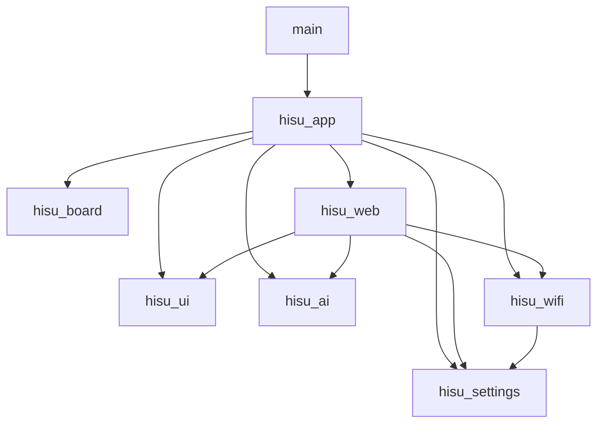

# Component ownership

Each component declares its direct dependencies and exports only its `include`
directory. Board profile headers are exported by `hisu_board`. Imported
`friend_*` symbols are retained for traceability and to avoid API renaming churn.

`hisu_app` is the composition root: it initializes services, binds callbacks,
restores media, starts the UI task, then starts the Wi-Fi manager. The UI has no
AI dependency; it notifies an app-bound callback when switching to media. The
Wi-Fi manager has no HTTP dependency; it invokes a service-start callback bound
by the app for online and setup states.

## Threads and ownership

- The UI task owns LVGL, subtitle rendering, media updates and timers.
- Button callbacks enqueue media commands or signal Wi-Fi setup; they do not draw.
- HTTP handlers submit media and AI requests through the existing queues.
- The AI worker performs HTTP requests and posts results for the UI task.
- Wi-Fi owns connection retries and the setup AP. Starting HTTP is idempotent.
- Register callbacks before worker tasks begin; do not replace them at runtime.
- PCM and power APIs require one owning task per stream/status reader.

`hisu_ai` exports an output callback contract. `hisu_app` binds availability,
show, active and clear callbacks to the UI; the AI component has no UI/board
dependency. The inherited `friend_ai_process_ui` name is retained for its result
pump, called only from the UI task. Cancellation marks the pending clear flag
rather than drawing from its caller. AI key/profile persistence remains inside
`hisu_ai`; Wi-Fi credentials belong to `hisu_settings`, media storage to `hisu_ui`.
These are explicit ownership boundaries, not a universal settings abstraction.

## Adding capabilities

Create a real component with `include`, `src`, a CMakeLists.txt and focused
dependencies when its behavior is implemented. Assemble it in `hisu_app`.

- Audio service: owns microphone/speaker streams, buffering and GMF/SR integration.
- Agent service: evaluates ESP-Claw runtime, capability registration and memory.
- Tool manager: validates requests and dispatches calls to local services.
- FriendLink: manages node identity, capability discovery, timeout and transport.

Drivers must not call AI/network services. New providers must not directly control
hardware. Keep transport details in adapters. Introduce abstractions at these
real integration boundaries rather than creating empty future modules.

## Adding a board

The baseline builds only ESP32-S3 Zhengchen. `boards/zhengchen_154` owns the pin
map and SDK defaults; generic ST7789/I2S drivers currently assume that hardware.
For another board, add its profile and implement/select matching drivers in
`hisu_board`. Move the chip target into per-board metadata when the first
non-S3 board is added. Use a separate build directory and sdkconfig per board
so stale generated configuration cannot override its defaults.

## Configuration and storage

Root SDK defaults hold application settings; board defaults hold flash, PSRAM
and console settings. `partitions.csv` retains the inherited media layout so
the media store's two fixed slots remain valid. OTA app slots exist, but there
is no OTA updater in this baseline.

The existing HTTP settings and unencrypted NVS key storage are prototype
behavior. Authentication/TLS/key storage need implementation before deployment
outside the intended trusted development network.
